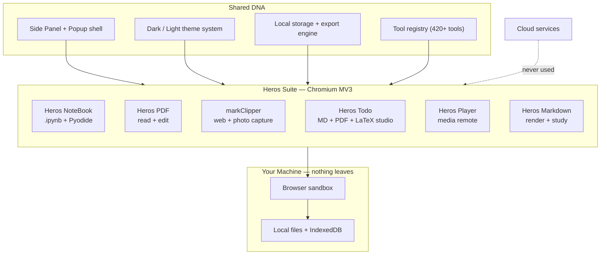
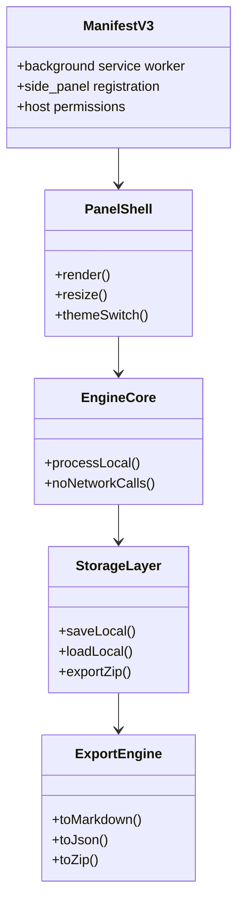
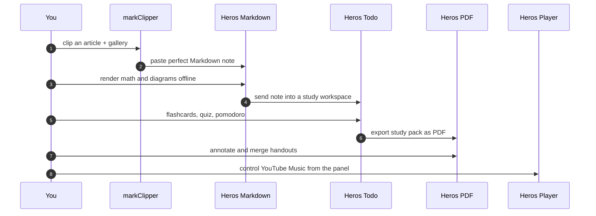
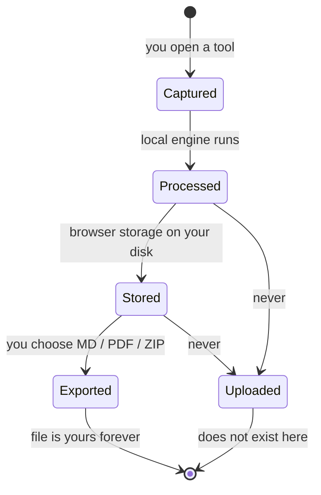
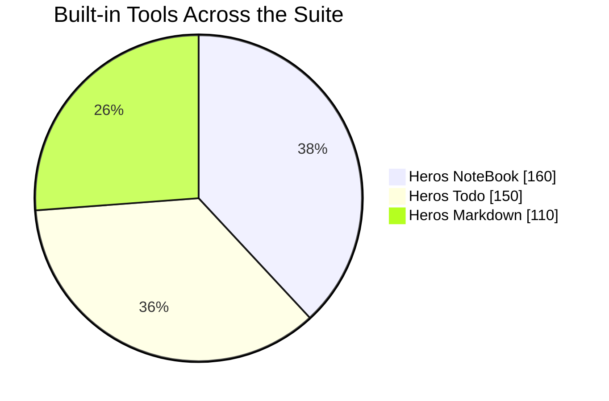
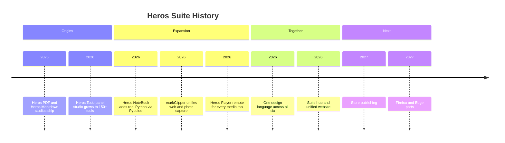
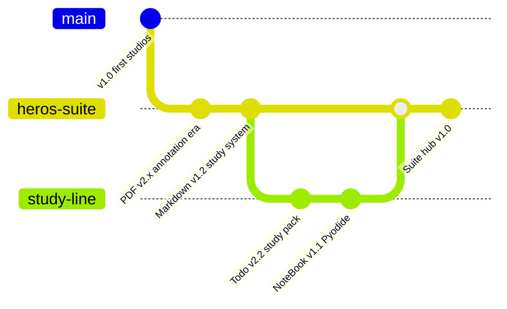
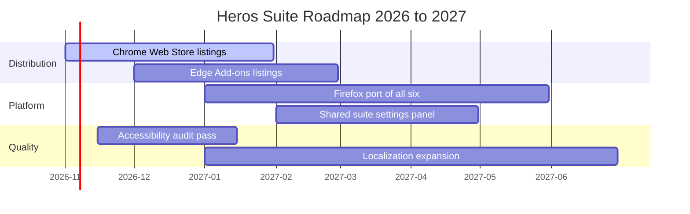
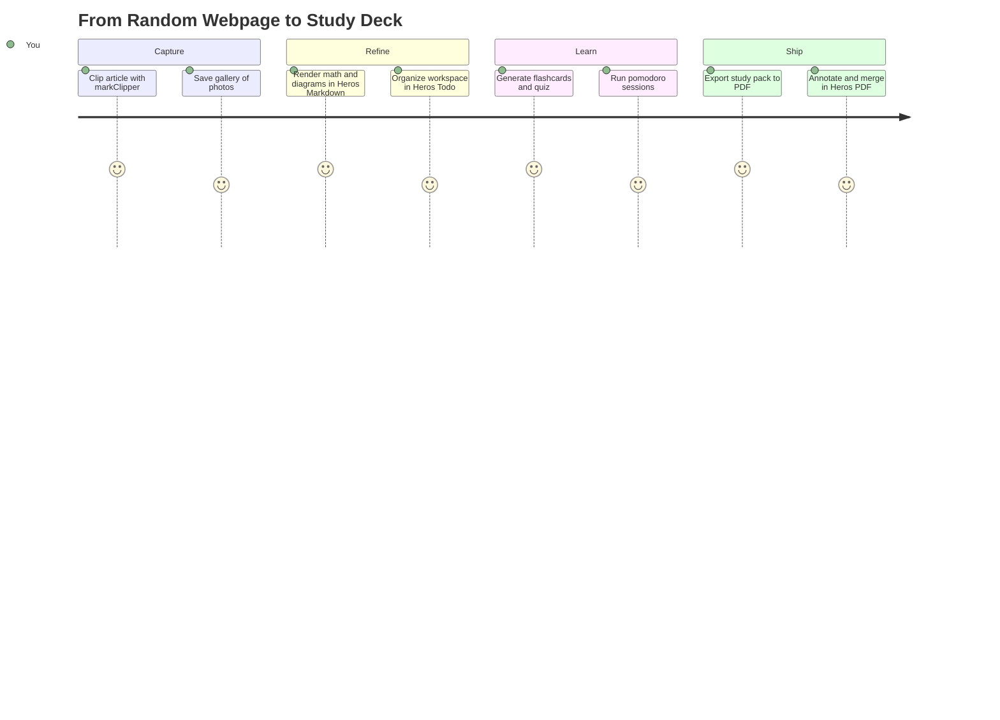
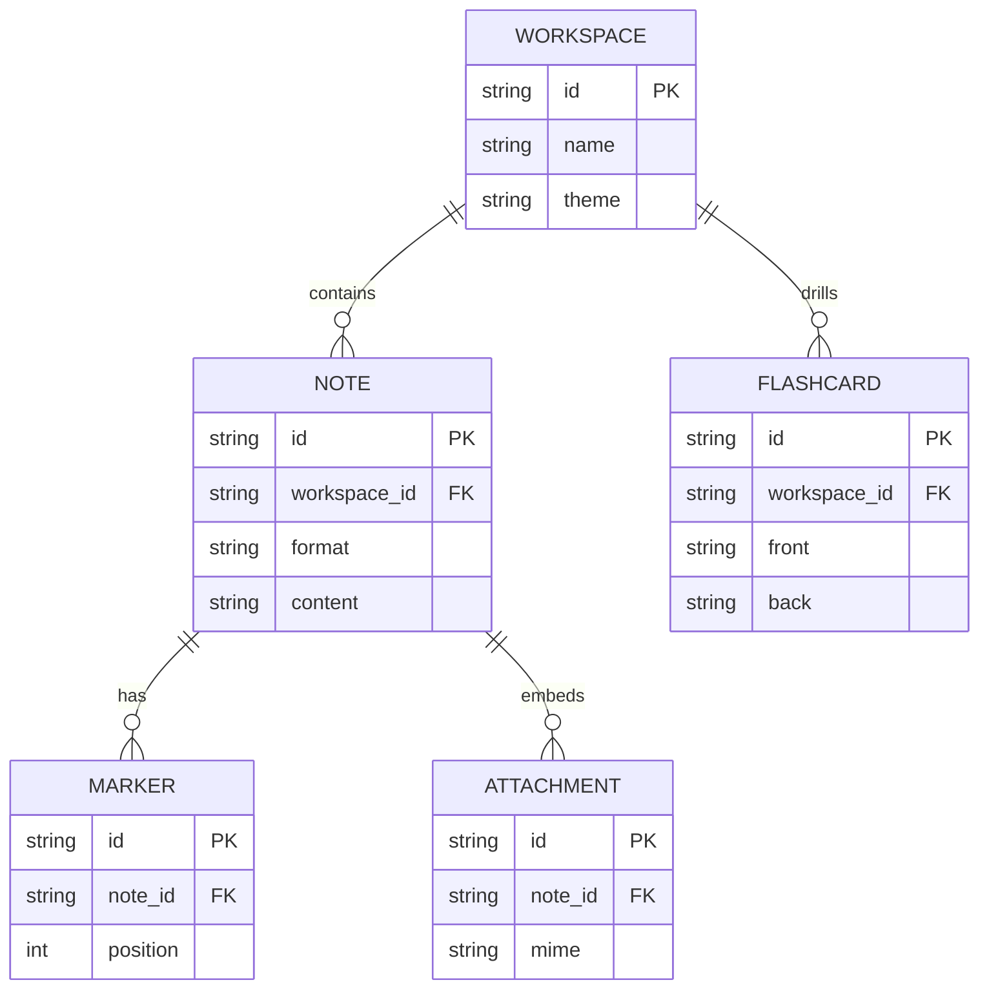

**The complete Heros browser suite — six free, private and unlimited extensions that replace a whole shelf of paid tools.**

One design language. 100% local processing. No accounts. No uploads. No limits.

[**Website**](https://ahmedbakr78.github.io/Heros_Suite/) &nbsp;·&nbsp; [**All Repositories**](#every-repository-in-the-suite) &nbsp;·&nbsp; [**Install Guide**](#installation) &nbsp;·&nbsp; [**Portfolio**](https://ahmed-abo-bakr.pages.dev/)

 

 

| 6 | 420+ | 100% | 0 | 4 | 0 |
|:---:|:---:|:---:|:---:|:---:|:---:|
| **Extensions** | **Built-in Tools** | **Local Processing** | **Accounts Needed** | **Chromium Browsers** | **Data Uploaded** |

---

## What Is the Heros Suite?

The Heros Suite is a family of **six Chromium (Manifest V3) browser extensions** built by [Ahmed Abo Bakr](https://ahmed-abo-bakr.pages.dev/) with a single philosophy:

> Tools should be **free forever**, run **on your machine**, and never ask for your data.

Every extension in the suite shares the same design language, the same privacy model and the same promise: open a side panel or popup, work locally, keep everything. No subscriptions, no trials, no accounts, no tracking, no uploads, no limits.

Together the six extensions cover the daily work of reading, writing, studying, researching, editing, playing and clipping — the entire shelf of tools a student, researcher or developer reaches for every day, rebuilt as one coherent suite.

---

## The Suite at a Glance

| Extension | What It Replaces | Repo | Website | Version | Flagship |
|---|---|---|---|---|---|
| **Heros NoteBook** | Jupyter web viewers, paid notebook runners | [Heros_Jupter](https://github.com/Ahmedbakr78/Heros_Jupter) | [Site](https://ahmedbakr78.github.io/Heros_Jupter/) | v1.1.0 | Real Python in the browser via Pyodide |
| **Heros PDF** | Paid PDF editors, online PDF sites | [Heros_PDF](https://github.com/Ahmedbakr78/Heros_PDF) | [Site](https://ahmedbakr78.github.io/Heros_PDF/) | v2.3.2 | Annotate, merge, split, watermark locally |
| **markClipper** | Read-later apps, clipping SaaS | [Heros_Note](https://github.com/Ahmedbakr78/Heros_Note) | [Site](https://ahmedbakr78.github.io/Heros_Note/) | v1.1.0 | Webpages and 250-photo galleries to Markdown |
| **Heros Todo** | Notion, Obsidian panels, study apps | [Heros_Todo](https://github.com/Ahmedbakr78/Heros_Todo) | [Site](https://ahmedbakr78.github.io/Heros_Todo/) | v2.2.0 | MD + PDF + LaTeX studio with 150+ tools |
| **Heros Player** | Media control widgets, remote apps | [Heros_Music_Player](https://github.com/Ahmedbakr78/Heros_Music_Player) | [Site](https://ahmedbakr78.github.io/Heros_Music_Player/) | v1.3.0 | Full remote for YouTube Music, YouTube and Spotify |
| **Heros Markdown** | Markdown editors, math previewers | [heros-markdown](https://github.com/Ahmedbakr78/heros-markdown) | [Site](https://ahmedbakr78.github.io/heros-markdown/) | v1.2.0 | Offline KaTeX + every Mermaid diagram, 110 tools |

---

## Why the Heros Suite

### The Local-First Promise

| Principle | What It Means |
|---|---|
| **Free forever** | No subscriptions, no premium tiers, no trials. Every feature, every tool, every time |
| **Unlimited** | No file caps, no note limits, no daily quotas, no locked exports |
| **100% local** | Processing happens in your browser. Files never leave your machine |
| **No accounts** | Nothing to sign up for, nothing to sign in to, nothing to leak |
| **No tracking** | No analytics beacons, no telemetry, no usage reports |
| **Open source** | MIT licensed, fully auditable, community contributions welcome |
| **Offline** | Works with the network cable pulled out |

### One Design Language

All six extensions ship the same experience contract:

- The same **panel-first layout** — everything opens in the browser side panel, never steals your tab
- The same **dark + light themes** tuned for long sessions and eye comfort
- The same **keyboard-first controls** with complete shortcut maps
- The same **mobile-ready responsive** rendering inside narrow panels
- The same **storage model** built on local browser storage you own and can export

---

## Suite Architecture

### Anatomy of a Heros Extension

### A Day With the Suite

### Where Your Data Lives

---

## The Six Extensions

### 1. Heros NoteBook — Jupyter Studio in Your Browser

> Open, read, run, edit, search and export `.ipynb` notebooks — with a **real Python runtime** powered by Pyodide WebAssembly.

| | |
|---|---|
| **Repository** | https://github.com/Ahmedbakr78/Heros_Jupter |
| **Website** | https://ahmedbakr78.github.io/Heros_Jupter/ |
| **Version** | v1.1.0 |
| **Tools** | 160 |

**Flagship features**

- Real Python execution in a sandboxed Pyodide WebAssembly kernel — no server, no install
- Beautiful notebook rendering: markdown cells, code cells, outputs, images, tables
- Search and outline engine across every cell of large notebooks
- Builder Studio and wizards for creating notebooks from scratch
- Variable inspector and execution state tracking
- Full export engine — notebooks back out as clean `.ipynb`, HTML or Markdown
- Dark + light themes, mobile-ready, works fully offline once loaded

---

### 2. Heros PDF — PDF Studio in Your Browser

> Read, mark up and edit PDFs **locally** — annotate, merge, split, rotate, watermark, search. No uploads, no page limits.

| | |
|---|---|
| **Repository** | https://github.com/Ahmedbakr78/Heros_PDF |
| **Website** | https://ahmedbakr78.github.io/Heros_PDF/ |
| **Version** | v2.3.2 |

**Flagship features**

- Fast, beautiful PDF reading with continuous scroll, zoom and page jump
- Annotation engine: highlights, notes and markup that stay on your copy
- Edit engine: merge, split, rotate and watermark documents without external services
- Full-text search across large documents with match navigation
- Dark + light themes with eye-comfort tuning for reading sessions
- Mobile-ready panel rendering for narrow layouts
- 100% local pipeline — documents never leave the browser sandbox

---

### 3. markClipper — Markdown Web Clipper + Photo Lab

> Save webpages, selections, bookmarks, screenshots and **250-photo galleries** into perfect Markdown notes.

| | |
|---|---|
| **Repository** | https://github.com/Ahmedbakr78/Heros_Note |
| **Website** | https://ahmedbakr78.github.io/Heros_Note/ |
| **Version** | v1.1.0 |

**Flagship features**

- Six capture modes: full article, selection, bookmark, screenshot, gallery, bulk download
- The Markdown pipeline: Readability extraction → Turndown conversion → clean YAML frontmatter
- Photo Lab: capture and organize up to 250-photo galleries into structured notes
- Context menu integration across every page
- Local library with search and organization of everything you have clipped
- Export and backup engine — your clips out as Markdown or ZIP, any time
- 100% local, no read-later cloud, no account

---

### 4. Heros Todo — Markdown · PDF · LaTeX Panel Studio

> A full study and writing studio in the side panel: **150+ tools** across Markdown, LaTeX, PDF, tasks, flashcards, quizzes, Anki export, pomodoro and habit tracking.

| | |
|---|---|
| **Repository** | https://github.com/Ahmedbakr78/Heros_Todo |
| **Website** | https://ahmedbakr78.github.io/Heros_Todo/ |
| **Version** | v2.2.0 |
| **Tools** | 150+ |

**Flagship features**

- All MD, TXT, TEX and PDF files from any folders, organized in multi-workspaces
- LaTeX math engine and diagram rendering directly in the panel
- Task engine with markers, due dates and clickable checklists
- Study system: flashcards, quizzes, Anki export, pomodoro timer, habit tracking
- Builder studio for assembling notes, study packs and documents
- Workspaces that keep subjects, projects and courses separate
- 100% local — your notes never sync anywhere unless you export them

---

### 5. Heros Player — Full Media Remote

> A complete remote for **YouTube Music, YouTube, Spotify and any media tab** — live song readout, seek, volume, shuffle, repeat and likes from the side panel.

| | |
|---|---|
| **Repository** | https://github.com/Ahmedbakr78/Heros_Music_Player |
| **Website** | https://ahmedbakr78.github.io/Heros_Music_Player/ |
| **Version** | v1.3.0 |

**Flagship features**

- Detect and control every playing media tab from one panel
- Live song readout: title, artist, artwork, progress
- Full transport: play, pause, next, previous, seek, volume
- Shuffle, repeat and like controls wired straight into the services
- Probe engine (herosProbe) + act engine (herosAct) with a freshness poll loop
- Works across YouTube Music, YouTube, Spotify and generic media tabs
- Panel-only — never disrupts the playing tab

---

### 6. Heros Markdown — Markdown Studio

> A free, private, unlimited Markdown studio: perfect rendering, **offline KaTeX math**, **every Mermaid diagram**, all languages and RTL — plus 110 study and writing tools.

| | |
|---|---|
| **Repository** | https://github.com/Ahmedbakr78/heros-markdown |
| **Website** | https://ahmedbakr78.github.io/heros-markdown/ |
| **Version** | v1.2.0 |
| **Tools** | 110 |

**Flagship features**

- Perfect GitHub-flavored Markdown rendering in the panel
- Offline KaTeX — math renders with no network, ever
- Every Mermaid diagram type rendered locally
- All languages and full RTL support
- Study system in depth: markers, flashcards, quizzes, tasks, stopwatch, habit tracking
- Complete Markdown support matrix, documented
- Backup and restore your workspace as files
- No cloud, no account, free forever

---

## Feature Comparison — The Suite Against the Cloud

| Capability | Heros Suite | Typical cloud tool |
|---|---|---|
| Price | Free forever | Subscription |
| Accounts | None | Required |
| File limits | Unlimited | Tiered |
| Data location | Your machine | Their servers |
| Works offline | Yes | No |
| Tracking | None | Analytics |
| Export locked behind paywall | Never | Common |
| Open source | MIT | Usually not |
| Runs in side panel | All six | Rarely |

---

## Complete Suite Matrix

| Capability | NoteBook | PDF | markClipper | Todo | Player | Markdown |
|---|:---:|:---:|:---:|:---:|:---:|:---:|
| Side panel layout | Yes | Yes | Yes | Yes | Yes | Yes |
| Dark + light themes | Yes | Yes | Yes | Yes | Yes | Yes |
| 100% local processing | Yes | Yes | Yes | Yes | Yes | Yes |
| Works offline | Yes | Yes | Yes | Yes | Yes | Yes |
| Export engine | Yes | Yes | Yes | Yes | — | Yes |
| Search | Yes | Yes | Yes | Yes | — | Yes |
| Keyboard shortcut map | Yes | Yes | Yes | Yes | Yes | Yes |
| Mobile-ready panel | Yes | Yes | Yes | Yes | Yes | Yes |
| No account needed | Yes | Yes | Yes | Yes | Yes | Yes |
| Unlimited usage | Yes | Yes | Yes | Yes | Yes | Yes |
| MIT licensed | Yes | Yes | Yes | Yes | Yes | Yes |

### Tools Distribution

---

## Installation

Every extension installs in about 30 seconds.

### Quickest Path — Load Unpacked

1. Clone or download any extension repository (links above)
2. Open your browser's extensions page:

| Browser | Extensions page |
|---|---|
| Chrome | `chrome://extensions` |
| Edge | `edge://extensions` |
| Brave | `brave://extensions` |
| Vivaldi | `vivaldi://extensions` |
| Opera | `opera://extensions` |

3. Enable **Developer mode**
4. Click **Load unpacked**
5. Select the extension folder inside the cloned repository:

| Extension | Folder to select |
|---|---|
| Heros NoteBook | `Heros_Jupter/` |
| Heros PDF | `Heros_PDF/pdf-studio-extension/` |
| markClipper | `Heros_Note/` |
| Heros Todo | `Heros_Todo/` |
| Heros Player | `Heros_Music_Player/heros-player-extension/` |
| Heros Markdown | `Heros_Markdown/` |

6. Pin the extension and open its side panel. Done.

Each repository also ships ready zip builds in its release section for one-click installs.

---

## Browser Support

| Browser | Status |
|---|---|
| Chrome | Fully supported — MV3 |
| Edge | Fully supported — MV3 |
| Brave | Fully supported — MV3 |
| Vivaldi | Fully supported — MV3 |
| Opera | Fully supported — MV3 |
| Firefox | On the roadmap — port in progress |

---

## Privacy and Security Model

The suite is built so that privacy is structural, not a setting:

- **No network calls in processing paths** — engines run on local WebAssembly and JavaScript
- **No remote analytics** — nothing phones home about your usage
- **No accounts, no sync servers** — browser storage and local files only
- **Auditable source** — MIT licensed code, readable end to end
- **Sandboxed execution** — notebook code runs in a Pyodide WebAssembly sandbox, not your system
- **You own exports** — every tool writes open formats: Markdown, PDF, ZIP, JSON

---

## The Heros Story

### Release Train

### Roadmap

---

## The Journey of a Clipped Idea

---

## Storage Model

Each extension stores data in local browser storage you can inspect, export and delete at any time.

---

## Every Repository in the Suite

| # | Extension | Repository | Website | Version | Release |
|---|---|---|---|---|---|
| 1 | Heros NoteBook | [Ahmedbakr78/Heros_Jupter](https://github.com/Ahmedbakr78/Heros_Jupter) | [Site](https://ahmedbakr78.github.io/Heros_Jupter/) | v1.1.0 | [Releases](https://github.com/Ahmedbakr78/Heros_Jupter/releases) |
| 2 | Heros PDF | [Ahmedbakr78/Heros_PDF](https://github.com/Ahmedbakr78/Heros_PDF) | [Site](https://ahmedbakr78.github.io/Heros_PDF/) | v2.3.2 | [Releases](https://github.com/Ahmedbakr78/Heros_PDF/releases) |
| 3 | markClipper | [Ahmedbakr78/Heros_Note](https://github.com/Ahmedbakr78/Heros_Note) | [Site](https://ahmedbakr78.github.io/Heros_Note/) | v1.1.0 | [Releases](https://github.com/Ahmedbakr78/Heros_Note/releases) |
| 4 | Heros Todo | [Ahmedbakr78/Heros_Todo](https://github.com/Ahmedbakr78/Heros_Todo) | [Site](https://ahmedbakr78.github.io/Heros_Todo/) | v2.2.0 | [Releases](https://github.com/Ahmedbakr78/Heros_Todo/releases) |
| 5 | Heros Player | [Ahmedbakr78/Heros_Music_Player](https://github.com/Ahmedbakr78/Heros_Music_Player) | [Site](https://ahmedbakr78.github.io/Heros_Music_Player/) | v1.3.0 | [Releases](https://github.com/Ahmedbakr78/Heros_Music_Player/releases) |
| 6 | Heros Markdown | [Ahmedbakr78/heros-markdown](https://github.com/Ahmedbakr78/heros-markdown) | [Site](https://ahmedbakr78.github.io/heros-markdown/) | v1.2.0 | [Releases](https://github.com/Ahmedbakr78/heros-markdown/releases) |

---

## FAQ

<b>Is the suite really free?</b>

 

Yes — all six extensions are free forever, MIT licensed, with no premium tier, no trial and no feature locks. There is nothing to buy and nothing to unlock.

<b>Where is my data stored?</b>

 

On your machine. Everything lives in local browser storage and local files. Nothing is uploaded. You can export everything to open formats at any time.

<b>Do I need an account?</b>

 

No. There are no accounts, no sign-ups and no logins anywhere in the suite.

<b>Does it work offline?</b>

 

Yes. All six extensions are built to run fully offline — math, diagrams, PDF editing, notebook execution and note editing all happen locally.

<b>Which browsers are supported?</b>

 

Every Chromium browser: Chrome, Edge, Brave, Vivaldi and Opera are fully supported today. A Firefox port is on the roadmap.

<b>Can I use the extensions together?</b>

 

Yes — that is the point of the suite. Clip with markClipper, refine in Heros Markdown, study in Heros Todo, export to PDF through Heros PDF. One design language means they feel like one product.

<b>How do I report a bug or request a feature?</b>

 

Open an issue in the repository of the relevant extension. Every repository has contributing guidelines and issue templates.

---

## About the Builder

**Ahmed Abo Bakr** — Big Data Engineer and builder, Cairo, Egypt. The Heros Suite is his gift to every student, researcher and developer who refuses to rent their own tools.

[Portfolio](https://ahmed-abo-bakr.pages.dev/) &nbsp;·&nbsp; [GitHub](https://github.com/Ahmedbakr78) &nbsp;·&nbsp; [LinkedIn](https://linkedin.com/in/ahmed-abo-bakr) &nbsp;·&nbsp; [Email](mailto:Ahmedbakr@internet.ru)

---

## Get the Suite

Six tools. Zero cost. Zero cloud. Yours forever.

 

2026 Ahmed Abo Bakr · Heros Suite · MIT License · Free forever, private forever.

